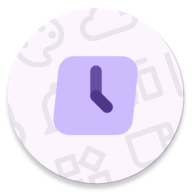
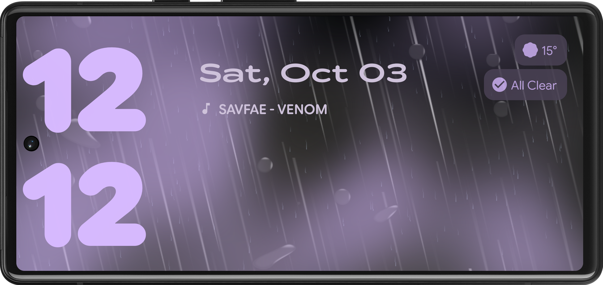

<div align="center">



# ClockDesk

**Give your old Android device a second life as a stylish, ambient desk clock & smart display.**

[](https://github.com/nx-d1frnt/ClockDesk/releases)
[-3DDC84.svg?style=flat-square&logo=android&logoColor=white)](https://developer.android.com)
[](https://developer.android.com)
[](https://kotlinlang.org)
[](LICENSE)
[](https://t.me/clockdesk_app)

<br />



</div>

---

## 📖 Overview

**ClockDesk** transforms any idle Android tablet or smartphone into a modern, glanceable bedside or workstation companion. Designed with both aesthetics and utility in mind, ClockDesk pairs rich personalization with built-in OLED burn-in prevention and energy-conscious rendering to ensure safe, long-term continuous display use.

Whether used as a standalone desk clock, your default device launcher, ClockDesk keeps you connected to your environment, media, and workstation with zero clutter.

---

## ✨ Key Features

### 🕒 Personalized Clock & Typography
- **Multiple Clock Styles:** Choose from clean digital styles, minimal typography, and customizable layouts.
- **Custom Font Engine:** Load your favorite `.ttf` / `.otf` fonts and fine-tune variable font weights and axes.
- **Fluid Visuals & Shaders:** Smooth entrance animations, and ambient shader effects.
- **Dynamic Palette Theming:** Seamlessly extracts dominant and vibrant colors from backgrounds.

### 🖼️ Dynamic & Interactive Backgrounds
- **Day / Night Cycle:** Live astronomical calculations adapting background gradients and moods based on your exact local sunrise and sunset.
- **Weather-Reactive Atmosphere:** Backgrounds that respond visually to real-time local weather conditions (rain, snow, clouds, clear skies).
- **Custom Wallpapers:** Import personal photos with built-in aspect-ratio cropping, configurable blur strength, and dimming controls.

### 🧩 Modular Smart Chips System
- **Glanceable Widgets:** Drag-and-drop customizable chips that display critical information without clutter:
  - ⛅ **Weather Chip:** Live conditions, temperature, and detailed forecast dialogs.
  - ⚠️ **Weather & Battery Alerts:** Severe weather notifications and high-temperature / battery-state warnings.
  - ⏰ **Alarm Chip:** Next scheduled alarm time and countdown.
  - 🔔 **Notification Chip:** Quick count badge and one-tap access to your notifications.
  - 🔄 **Update Chip:** Direct notification and changelog preview when new updates are available.
  - 📱 **DeskConnect Companion Chips:** Displays paired device battery status and connection notifications.
- **Expandable Stacks:** Smart chip overflow handling with collapsible stack animations and badge counters.
- **Extensible Plugin Architecture:** Third-party applications can supply custom chips via standard Android intents (`com.nxd1frnt.clockdesk2.ACTION_QUERY_SMART_CHIPS`).

### 🎵 "Now Playing" Music Integration
- **System Media Session:** Automatically detects and displays playback status, track metadata, and album artwork from active media apps (Spotify, Apple Music, YouTube Music, etc.) with playback controls.
- **Last.fm Support:** Native integration to display your live scrobbling activity directly on screen.
- **Flexible Widget Layouts:** Switch between compact, expanded, and minimal media layouts with media source icon badges.
- **Modular Music Sources:** Reorder and toggle media providers using the unified plugin system.

### DeskConnect (KDE Connect Integration) `[Experimental]`
- **Seamless Local Pairing:** Connect ClockDesk with your PC, laptop, or other devices using the trusted, open KDE Connect protocol over local Wi-Fi with TLS/RSA encryption.
- **Workstation Media Sync (MPRIS):** View and control music or video playing on your computer directly from your desk clock, complete with album art streaming.
- **Cross-Device Notifications:** Mirror PC notifications straight to ClockDesk with interactive swipe-to-dismiss.
- **Companion Telemetry:** Keep an eye on your laptop or phone battery level right from your bedside or desk.

### 🔔 Ambient & Floating Notifications
- **Floating Banner Notifications:** Configurable heads-up desk banners with customizable screen positions, scaling, typography, and Monet dynamic styling.
- **Interactive Live Preview:** Test your notification layout, animations, and typography directly from the settings screen.
- **Notification Shade Sheet:** Access an ambient bottom sheet displaying active notifications with smooth dismiss gestures.

### 🛡️ OLED & Screen Longevity
- **Burn-In Protection:** Subtle, periodic pixel shifting to prevent static image retention during continuous 24/7 desk use, with configurable shift distance.
- **Smart Pixels (AMOLED Saver):** Selectively turns off a Bayer matrix grid of OLED sub-pixels to drastically cut power draw and heat generation, complete with live intensity preview.
- **Power State Optimization:** Automatically adapts update frequencies and rendering overhead when running on battery or in low-power modes.

### 🖥️ Launcher & Kiosk Friendly
- **Home / Kiosk Mode:** Can be set as the default Android Launcher (`HOME` intent) to turn older devices into dedicated smart displays.
- **Interactive Drag-to-Position:** Freely adjust the position and ordering of clock, date, and widget elements to fit your setup and stand angle.
- **Settings Backup & Restore:** Export and import your customized configuration to JSON with ease.

---

## 🛠️ Tech Stack & Architecture

- **Language:** Kotlin (100%)
- **UI & Architecture:** Material Components 3, custom M3 Settings DSL, AndroidX ConstraintLayout, and custom OpenGL ES (GLSL) Shaders.
- **Networking & Connectivity:**
  - Volley HTTP library with caching for weather and geocoding services.
  - Native DeskConnect engine with UDP socket discovery and TLS communication backed by [BouncyCastle](https://www.bouncycastle.org/).
- **Image Processing & Graphics:** [Glide](https://github.com/bumptech/glide), [AndroidX Palette](https://developer.android.com/develop/ui/views/graphics/palette-colors), [ColorPickerView](https://github.com/skydoves/ColorPickerView)
- **Storage & State:** AndroidX Preferences with JSON backup/restore engine.

---

## 🌐 Supported Languages

ClockDesk is available in:
- 🇬🇧 English
- 🇺🇦 Ukrainian (Українська)
- 🇷🇺 Russian (Русский)

---

## 🚀 Getting Started

### Prerequisites
- **Minimum Android Version:** Android 6.0 Marshmallow (`API 23`) or higher.
- **Recommended Setup:** Keep your device plugged into a dock or charger with landscape orientation enabled.

### Permissions
For the best experience, ClockDesk utilizes:
- **Location (`ACCESS_COARSE_LOCATION` / `ACCESS_FINE_LOCATION`):** Required for automated sunrise/sunset calculation and local weather forecasts.
- **Notification Listener Access:** Required if you want the "Now Playing" widget to read media sessions from your device.
- **Local Network & Wi-Fi State (`INTERNET`, `ACCESS_NETWORK_STATE`, `ACCESS_WIFI_STATE`, `CHANGE_WIFI_MULTICAST_STATE`):** Required for weather updates and DeskConnect local device discovery/sync.
- **Request Install Packages (`REQUEST_INSTALL_PACKAGES`):** Optional, enables seamless in-app updates directly from GitHub releases without manual file opening.

### Installation & Updates

#### 1. Download via GitHub Releases
1. Download the latest APK matching your device architecture (or Universal) from the **[Releases](https://github.com/nx-d1frnt/ClockDesk/releases)** page.
2. Allow installation from unknown sources if prompted.
3. Open **ClockDesk**, grant permissions, and follow the interactive tutorial!

#### 2. Built-In In-App Updater
ClockDesk features an automated update engine:
- Automatic ABI detection matching your exact CPU architecture (ARM64, ARMv7, x86_64, or Universal).
- Switch between **Stable** and **Nightly** release channels directly in *Settings → Updates*.
- One-tap download with direct APK installation.

### Building from Source
Ensure you have the Android SDK and JDK 11+ (or JDK 17) installed:

```bash
# Clone the repository
git clone https://github.com/nx-d1frnt/ClockDesk.git
cd ClockDesk

# Build debug APK
./gradlew assembleDebug

# Output APK location:
# app/build/outputs/apk/debug/
```

---

## 🔌 Developing Plugins

ClockDesk 2.0 features an open plugin contract allowing external apps to provide custom widgets and music sources:

- **Smart Chips Action:** `com.nxd1frnt.clockdesk2.ACTION_QUERY_SMART_CHIPS`
- **Music Plugins Action:** `com.nxd1frnt.clockdesk2.music.PLUGIN`

Implement the plugin intent filters and contracts in your Android app to seamlessly display custom telemetry, IoT metrics, or media feeds on the ClockDesk display.

---

## 🤝 Contributing

Contributions, bug reports, and feature requests are welcome!

1. Fork the Project
2. Create your Feature Branch (`git checkout -b feature/AmazingFeature`)
3. Commit your Changes (`git commit -m 'Add some AmazingFeature'`)
4. Push to the Branch (`git push origin feature/AmazingFeature`)
5. Open a Pull Request

---

## 📄 License

Distributed under the **MIT License**. See [`LICENSE`](LICENSE) for details.

---

<div align="center">
  <sub>Created with ❤️ by <a href="https://github.com/nx-d1frnt">nx-d1frnt</a></sub>
</div>
